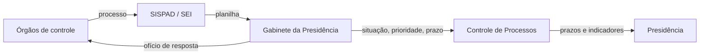

# Documentação de Contexto

| Projeto | Documento | Versão | Data | Autor |
|---|---|---|---|---|
| Controle de Processos do Gabinete | 01. Documentação de Contexto | 1.2 | 23/11/2026 | Bruno-LSO |

**Histórico de versões**

| Versão | Data | Autor | Alteração |
|---|---|---|---|
| 1.0 | 22/11/2026 | Bruno-LSO | Primeira versão |
| 1.1 | 23/11/2026 | Bruno-LSO | Prazo individual por processo, data de conclusão com botão Concluir e Painel com evolução e tempo de resolução |
| 1.2 | 23/11/2026 | Bruno-LSO | Só o prazo informado pelo órgão (saem regras de prazo e feriados) e análise do prazo dado por órgão |

## Introdução

O Gabinete da Presidência do Confea recebe processos de órgãos de controle: Tribunal de Contas da União (TCU), Ministério Público Federal (MPF), Polícia Federal, Ministério Público do Trabalho (MPT), Controladoria-Geral da União (CGU), Advocacia-Geral da União (AGU), Procuradoria-Geral da República (PGR) e Ministérios Públicos estaduais. Cada processo pede uma resposta do Confea dentro de um prazo.

Até novembro de 2026 o acompanhamento era feito numa planilha exportada do SISPAD. A planilha de 17/11/2026 tem 673 processos e 13 colunas. As colunas "Situação do Processo", "Prioridade", "Data de recebimento" e "Prazo para resposta" estão vazias em todas as linhas.

## Problema

| Código | Problema |
|---|---|
| P-01 | O prazo para resposta não fica visível. Um prazo vencido só aparece se alguém abrir a planilha e procurar. |
| P-02 | Não existe um registro único da situação de cada processo dentro do Gabinete. |
| P-03 | Não existe prioridade registrada. |
| P-04 | Várias pessoas trabalham em cópias diferentes da planilha. A informação fica desatualizada. |
| P-05 | Não existe registro de quem alterou o quê e quando. |
| P-06 | Não existe medida do volume de processos ao longo do tempo nem do tempo de resolução por órgão e por tipo. |
| P-07 | Cada órgão dá o próprio prazo em cada processo. Não se sabe qual prazo cada órgão costuma dar nem quando um prazo foge do habitual. |

## Objetivos

**Objetivo geral:** dar ao Gabinete um controle único, sempre atualizado, dos processos de órgãos de controle, com o prazo para resposta em destaque.

**Objetivos específicos:**

1. Mostrar o prazo para resposta de cada processo com cor por urgência (P-01).
2. Registrar a situação do processo em 5 etapas (P-02).
3. Registrar a prioridade em 3 níveis com cor (P-03).
4. Manter os dados num banco único, com atualização ao vivo em todas as telas abertas (P-04).
5. Registrar cada ação com pessoa, data, hora e mudança, em frase simples (P-05).
6. Mostrar a evolução do número de processos e o tempo médio de resolução, com filtro por órgão, tipo, UF e período (P-06).
7. Mostrar, por órgão, a média, o desvio padrão e a faixa normal dos prazos dados, e apontar os prazos fora do padrão (P-07).

## Justificativa

Um prazo perdido com o TCU ou com o Ministério Público pode gerar multa, representação ou desgaste institucional para o Confea. O controle precisa ser visível para quem decide e simples para quem registra.

## Público-alvo

| Parte interessada | Papel | Interesse |
|---|---|---|
| Talita Machado, Gabinete da Presidência | Pediu o sistema e registra a situação, a prioridade e os prazos | Ver os prazos e manter a planilha em dia |
| Equipe do Gabinete | Consulta e atualiza processos | Saber o que vence primeiro |
| Presidência do Confea | Consulta | Ver os processos críticos e vencidos |
| Bruno-LSO, gerente de dados | Desenvolve e administra | Manter o sistema e o banco |

