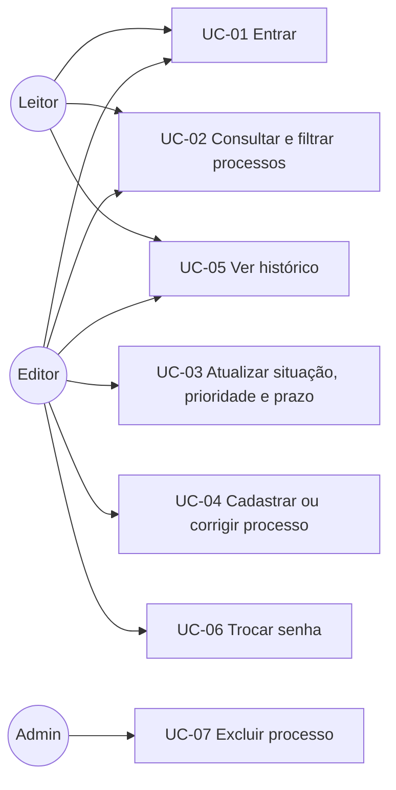
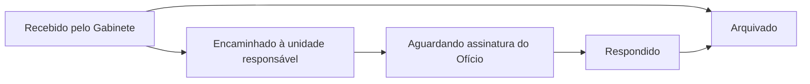
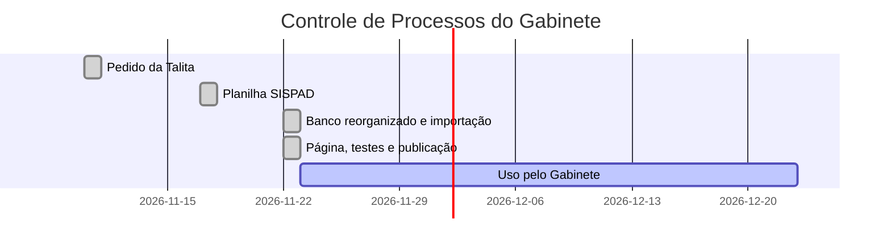

# Especificação do Projeto

| Projeto | Documento | Versão | Data | Autor |
|---|---|---|---|---|
| Controle de Processos do Gabinete | 02. Especificação do Projeto | 1.1 | 22/11/2026 | Bruno-LSO |

**Histórico de versões**

| Versão | Data | Autor | Alteração |
|---|---|---|---|
| 1.0 | 22/11/2026 | Bruno-LSO | Primeira versão |
| 1.1 | 22/11/2026 | Bruno-LSO | Regras de prazo por órgão e tipo, dias úteis ou corridos, feriados e cálculo automático |

## Personas

| Persona | Descrição |
|---|---|
| Talita, assessora do Gabinete | Recebe os processos, encaminha às unidades e acompanha os ofícios de resposta. Usa computador no escritório e celular fora dele. |
| Presidente ou chefe de gabinete | Quer ver em segundos o que está vencido e o que é crítico. Usa principalmente o celular. |

## Histórias de usuário

| Código | Como | Quero | Para |
|---|---|---|---|
| HU-01 | assessora do Gabinete | ver os prazos vencidos e os que vencem em 7 dias | responder antes de perder o prazo |
| HU-02 | assessora do Gabinete | registrar a situação e a prioridade de cada processo | mostrar em que etapa cada um está |
| HU-03 | assessora do Gabinete | filtrar por órgão, UF, situação, prioridade e prazo | achar rapidamente um grupo de processos |
| HU-04 | chefia | ver indicadores diretos na primeira tela | decidir sem abrir planilha |
| HU-05 | administrador | saber quem alterou cada processo e quando | ter controle e prestar contas |
| HU-06 | qualquer usuário | usar o sistema no celular sem rolar a tela | consultar fora do escritório |

## Requisitos funcionais

| Código | Requisito | Prioridade | Origem |
|---|---|---|---|
| RF-001 | Entrar com usuário e senha; só quem tem perfil no projeto vê os dados | Alta | Pedido do Bruno, 22/11/2026 |
| RF-002 | Mostrar a lista de processos com prazo, prioridade, situação, órgão, número, assunto, UF e tipo | Alta | Planilha SISPAD de 17/11/2026 |
| RF-003 | Destacar o prazo para resposta por cor: vencido ou vence hoje em vermelho, 1 a 3 dias em laranja, 4 a 7 dias em amarelo | Alta | Talita, 10/11/2026 ("precisa ficar gritante") |
| RF-004 | Registrar a situação do processo: Recebido pelo Gabinete, Encaminhado à unidade responsável, Aguardando assinatura do Ofício, Respondido, Arquivado | Alta | Talita, 10/11/2026 |
| RF-005 | Registrar a prioridade: Crítica (vermelho), Alta (laranja), Normal (verde) | Alta | Talita, 10/11/2026 |
| RF-006 | Registrar data de recebimento, prazo para resposta e observação | Alta | Planilha SISPAD de 17/11/2026 |
| RF-007 | Mostrar 5 indicadores que filtram a lista ao clicar | Alta | Pedido do Bruno, 22/11/2026 |
| RF-008 | Filtrar por texto, situação, prioridade, prazo, órgão, UF, tipo e situação histórica (AGS) | Alta | Pedido do Bruno, 22/11/2026 |
| RF-009 | Cadastrar processo novo e corrigir os dados de um processo | Média | Uso contínuo do controle |
| RF-010 | Registrar cada ação (entrada, saída, cadastro, alteração, exclusão, troca de senha) com pessoa, data, hora e mudança em frase simples | Alta | Pedido do Bruno, 22/11/2026 |
| RF-011 | Mostrar o histórico geral e o histórico de cada processo | Alta | Pedido do Bruno, 22/11/2026 |
| RF-012 | Atualizar ao vivo as telas abertas quando outra pessoa altera um processo | Alta | Pedido do Bruno, 22/11/2026 |
| RF-013 | Trocar a própria senha | Média | Segurança da conta |
| RF-014 | Baixar a lista filtrada em CSV | Baixa | Uso da planilha pelo Gabinete |
| RF-015 | Configurar o prazo padrão por órgão e por tipo de procedimento, em dias corridos ou dias úteis | Alta | Pedido do Bruno, 22/11/2026 |
| RF-016 | Calcular o prazo para resposta pela regra a partir da data de recebimento, e recalcular quando a regra ou os feriados mudam | Alta | Pedido do Bruno, 22/11/2026 |
| RF-017 | Manter a lista de feriados e dias sem expediente usada na contagem | Alta | Contagem em dias úteis (RF-015) |
| RF-018 | Permitir prazo definido à mão em um processo, fora da regra | Média | Ofício com prazo próprio |

## Requisitos não funcionais

| Código | Requisito | Origem |
|---|---|---|
| RNF-001 | Toda a tela cabe na janela, sem rolagem vertical nem horizontal, de 320 x 568 px a 2560 x 1440 px, inclusive celular deitado | Pedido do Bruno, 22/11/2026 |
| RNF-002 | Nenhum elemento sobreposto a outro | Pedido do Bruno, 22/11/2026 |
| RNF-003 | Os dados só saem do banco para usuário com perfil no projeto (RLS) | Lei 13.709/2018 (LGPD) e pedido do Bruno |
| RNF-004 | Nenhum dado da planilha original perdido: a linha original fica gravada em `origem` | Pedido do Bruno, 22/11/2026 |
| RNF-005 | Carregar os 673 processos numa consulta e filtrar no navegador, sem nova ida ao banco | Pedido do Bruno: resposta mais rápida e menor consumo |
| RNF-006 | Duas pessoas não sobrescrevem a alteração uma da outra (controle por `atualizado_em`) | Integridade dos dados |

## Restrições

| Código | Restrição |
|---|---|
| R-01 | Hospedagem gratuita no GitHub Pages da organização `cnfpresiddata` |
| R-02 | Banco no projeto Supabase `rmjlqngrfgorhcwaarou`, compartilhado com outros projetos do Confea, cada um no próprio schema |
| R-03 | A planilha não traz situação, prioridade, data de recebimento nem prazo (0 de 673 linhas): esses campos começam vazios e o Gabinete preenche |
| R-04 | Só o TCU traz tipo de procedimento (16 tipos); MPF, Polícia Federal, MPT, CGU, AGU, PGR e MPs estaduais não trazem tipo, e a regra deles é por órgão |

## Casos de uso

## Processo de trabalho

## Matriz de rastreabilidade

| Problema | Requisitos |
|---|---|
| P-01 | RF-003, RF-007, RF-015, RF-016, RF-017, RF-018 |
| P-02 | RF-004, RF-011 |
| P-03 | RF-005, RF-007 |
| P-04 | RF-012, RNF-005, RNF-006 |
| P-05 | RF-010, RF-011 |

## Cronograma

## Equipe

| Pessoa | Papel |
|---|---|
| Bruno-LSO | Desenvolvimento, banco e administração |
| Talita Machado | Pedido, validação e uso |
