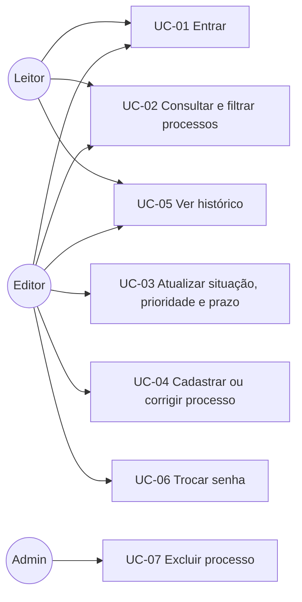
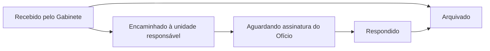

# Especificação do Projeto

| Projeto | Documento | Versão | Data | Autor |
|---|---|---|---|---|
| Controle de Processos do Gabinete | 02. Especificação do Projeto | 1.5 | 23/11/2026 | Bruno-LSO |

**Histórico de versões**

| Versão | Data | Autor | Alteração |
|---|---|---|---|
| 1.0 | 22/11/2026 | Bruno-LSO | Primeira versão |
| 1.1 | 22/11/2026 | Bruno-LSO | Regras de prazo por órgão e tipo, dias úteis ou corridos, feriados e cálculo automático |
| 1.2 | 22/11/2026 | Bruno-LSO | Projeto independente: perfis, log, rótulos, funções e logins no schema sispad |
| 1.3 | 22/11/2026 | Bruno-LSO | Identidade visual do Confea (design system do Claude Design), botão Início e ajuda com ? em cada seção |
| 1.4 | 23/11/2026 | Bruno-LSO | Prazo individual por processo, data de conclusão com botão Concluir e Painel com evolução e tempo de resolução |
| 1.5 | 23/11/2026 | Bruno-LSO | Só o prazo informado pelo órgão (saem regras de prazo e feriados) e análise do prazo dado por órgão |

## Personas

| Persona | Descrição |
|---|---|
| Talita, assessora do Gabinete | Recebe os processos, encaminha às unidades e acompanha os ofícios de resposta. Usa computador no escritório e celular fora dele. |
| Presidente ou chefe de gabinete | Quer ver em segundos o que está vencido e o que é crítico. Usa principalmente o celular. |

## Histórias de usuário

| Código | Como | Quero | Para |
|---|---|---|---|
| HU-01 | assessora do Gabinete | ver os prazos vencidos e os que vencem em 7 dias | responder antes de perder o prazo |
| HU-02 | assessora do Gabinete | registrar a situação e a prioridade de cada processo | mostrar em que etapa cada um está |
| HU-03 | assessora do Gabinete | filtrar por órgão, UF, situação, prioridade e prazo | achar rapidamente um grupo de processos |
| HU-04 | chefia | ver indicadores diretos na primeira tela | decidir sem abrir planilha |
| HU-05 | administrador | saber quem alterou cada processo e quando | ter controle e prestar contas |
| HU-06 | qualquer usuário | usar o sistema no celular sem rolar a tela | consultar fora do escritório |
| HU-07 | assessora do Gabinete | registrar o prazo que cada órgão deu e a data de conclusão | medir se o Gabinete responde no prazo |
| HU-09 | chefia | saber qual prazo cada órgão costuma dar e quais prazos fogem do padrão | negociar prazo e priorizar os casos atípicos |
| HU-08 | chefia | ver a evolução dos processos e o tempo médio de resolução por órgão e por tipo | planejar a equipe e cobrar as unidades |

## Requisitos funcionais

| Código | Requisito | Prioridade | Origem |
|---|---|---|---|
| RF-001 | Entrar com usuário e senha; só quem tem perfil no projeto vê os dados | Alta | Pedido do Bruno, 22/11/2026 |
| RF-002 | Mostrar a lista de processos com prazo, prioridade, situação, órgão, número, assunto, UF e tipo | Alta | Planilha SISPAD de 17/11/2026 |
| RF-003 | Destacar o prazo para resposta por cor: vencido ou vence hoje em vermelho, 1 a 3 dias em laranja, 4 a 7 dias em amarelo | Alta | Talita, 10/11/2026 ("precisa ficar gritante") |
| RF-004 | Registrar a situação do processo: Recebido pelo Gabinete, Encaminhado à unidade responsável, Aguardando assinatura do Ofício, Respondido, Arquivado | Alta | Talita, 10/11/2026 |
| RF-005 | Registrar a prioridade: Crítica (vermelho), Alta (laranja), Normal (verde) | Alta | Talita, 10/11/2026 |
| RF-006 | Registrar data de recebimento, prazo para resposta e observação | Alta | Planilha SISPAD de 17/11/2026 |
| RF-007 | Mostrar 5 indicadores que filtram a lista ao clicar | Alta | Pedido do Bruno, 22/11/2026 |
| RF-008 | Filtrar por texto, situação, prioridade, prazo, órgão, UF, tipo e situação histórica (AGS) | Alta | Pedido do Bruno, 22/11/2026 |
| RF-009 | Cadastrar processo novo e corrigir os dados de um processo | Média | Uso contínuo do controle |
| RF-010 | Registrar cada ação (entrada, saída, cadastro, alteração, exclusão, troca de senha) com pessoa, data, hora e mudança em frase simples | Alta | Pedido do Bruno, 22/11/2026 |
| RF-011 | Mostrar o histórico geral e o histórico de cada processo | Alta | Pedido do Bruno, 22/11/2026 |
| RF-012 | Atualizar ao vivo as telas abertas quando outra pessoa altera um processo | Alta | Pedido do Bruno, 22/11/2026 |
| RF-013 | Trocar a própria senha | Média | Segurança da conta |
| RF-014 | Baixar a lista filtrada em CSV | Baixa | Uso da planilha pelo Gabinete |
| RF-015 | Retirado em 23/11/2026: regras de prazo por órgão e tipo. Cada processo tem o prazo dado pelo órgão | Não se aplica | Pedido do Bruno, 23/11/2026 |
| RF-016 | Retirado em 23/11/2026: cálculo do prazo pela regra | Não se aplica | Pedido do Bruno, 23/11/2026 |
| RF-017 | Retirado em 23/11/2026: lista de feriados usada no cálculo | Não se aplica | Pedido do Bruno, 23/11/2026 |
| RF-018 | Prazo de cada processo informado pelo órgão demandante; é a única forma de prazo | Alta | Talita, via Bruno, 23/11/2026: cada processo tem um prazo específico, sempre informado pelo órgão |
| RF-019 | Botão Início sempre visível, com efeito suave, que volta à tela inicial | Alta | Pedido do Bruno, 22/11/2026 |
| RF-020 | Ponto de interrogação em cada seção, com explicação fácil e exemplos reais da página, de cada card e de como preencher | Alta | Pedido do Bruno, 22/11/2026 |
| RF-021 | Identidade visual do Confea, limpa e direta, com efeitos tecnológicos | Média | Pedido do Bruno, 22/11/2026 |
| RF-022 | Mostrar o prazo do dia do recebimento ao dia final, com o número de dias corridos | Alta | Pedido do Bruno, 23/11/2026 |
| RF-023 | Registrar a data de conclusão. O botão Concluir propõe a data de hoje quando ela está vazia, permite trocar e só grava depois da confirmação | Alta | Pedido do Bruno, 23/11/2026 |
| RF-024 | Recusar data de recebimento e data de conclusão no futuro, e conclusão antes do recebimento, na página e no banco | Alta | Pedido do Bruno, 23/11/2026 |
| RF-025 | Painel com gráfico de barras de processos recebidos e concluídos por mês (padrão), semana ou ano; números de recebidos, concluídos, em aberto, tempo médio de resolução e concluídos no prazo; tempo médio por órgão e por tipo; filtros por órgão, tipo, UF e período | Alta | Pedido do Bruno, 23/11/2026 |
| RF-027 | Painel com o prazo dado por órgão: média, desvio padrão, mediana, quartis, menor e maior prazo, faixa normal e número de prazos fora do padrão (regra de Tukey, com 5 prazos ou mais do órgão) | Alta | Pedido do Bruno, 23/11/2026 |
| RF-028 | Na tela do processo, comparar o prazo dado com a faixa normal do mesmo órgão | Alta | Pedido do Bruno, 23/11/2026 |
| RF-026 | Clicar em qualquer barra, linha ou número do painel abre uma janela com os processos da seleção; cada processo abre a sua tela, e o botão ‹ Painel volta à janela | Alta | Pedido do Bruno, 23/11/2026 |

## Requisitos não funcionais

| Código | Requisito | Origem |
|---|---|---|
| RNF-001 | Toda a tela cabe na janela, sem rolagem vertical nem horizontal, de 320 x 568 px a 2560 x 1440 px, inclusive celular deitado | Pedido do Bruno, 22/11/2026 |
| RNF-002 | Nenhum elemento sobreposto a outro | Pedido do Bruno, 22/11/2026 |
| RNF-003 | Os dados só saem do banco para usuário com perfil no projeto (RLS) | Lei 13.709/2018 (LGPD) e pedido do Bruno |
| RNF-004 | Nenhum dado da planilha original perdido: a linha original fica gravada em `origem` | Pedido do Bruno, 22/11/2026 |
| RNF-005 | Carregar os 673 processos numa consulta e filtrar no navegador, sem nova ida ao banco | Pedido do Bruno: resposta mais rápida e menor consumo |
| RNF-006 | Duas pessoas não sobrescrevem a alteração uma da outra (controle por `atualizado_em`) | Integridade dos dados |
| RNF-007 | As mudanças de 23/11/2026 não alteram nenhum processo, data ou prazo gravado: acrescentam `data_conclusao` e retiram `prazo_modo`, `regra_id`, `regras_prazo` (vazia) e `feriados`, com cópia de segurança antes | Pedido do Bruno, 23/11/2026 |

## Restrições

| Código | Restrição |
|---|---|
| R-01 | Hospedagem gratuita no GitHub Pages da organização `cnfpresiddata` |
| R-02 | Banco no projeto Supabase `rmjlqngrfgorhcwaarou`, que hospeda outros projetos do Confea. Cada projeto é 100% independente, no próprio schema, com perfis, log, funções e logins próprios (regra do Bruno, 22/11/2026). Nenhuma mudança pode quebrar o link de uma página publicada |
| R-03 | A planilha não traz situação, prioridade, data de recebimento nem prazo (0 de 673 linhas): esses campos começam vazios e o Gabinete preenche |
| R-04 | Só o TCU traz tipo de procedimento (16 tipos); MPF, Polícia Federal, MPT, CGU, AGU, PGR e MPs estaduais não trazem tipo |

## Casos de uso

## Processo de trabalho

## Matriz de rastreabilidade

| Problema | Requisitos |
|---|---|
| P-01 | RF-003, RF-007, RF-018 |
| P-02 | RF-004, RF-011 |
| P-03 | RF-005, RF-007 |
| P-04 | RF-012, RNF-005, RNF-006 |
| P-05 | RF-010, RF-011 |
| P-06 | RF-022, RF-023, RF-024, RF-025, RF-026 |
| P-07 | RF-027, RF-028 |

## Cronograma

## Equipe

| Pessoa | Papel |
|---|---|
| Bruno-LSO | Desenvolvimento, banco e administração |
| Talita Machado | Pedido, validação e uso |
