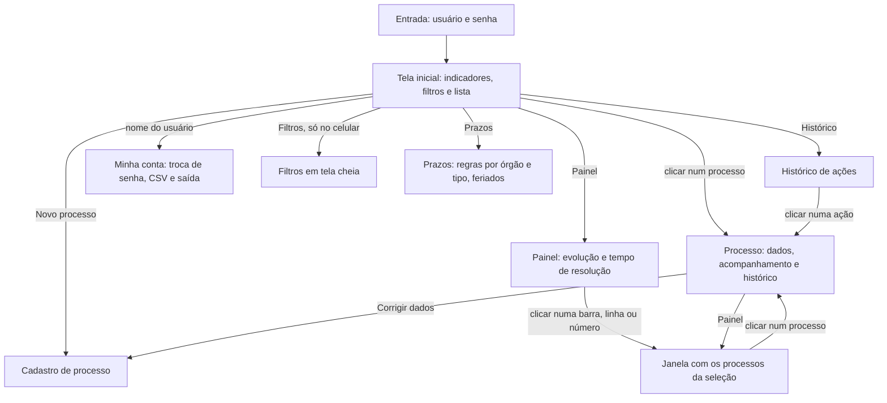

# Projeto de Interface

| Projeto | Documento | Versão | Data | Autor |
|---|---|---|---|---|
| Controle de Processos do Gabinete | 04. Projeto de Interface | 1.4 | 23/11/2026 | Bruno-LSO |

**Histórico de versões**

| Versão | Data | Autor | Alteração |
|---|---|---|---|
| 1.0 | 22/11/2026 | Bruno-LSO | Primeira versão |
| 1.1 | 22/11/2026 | Bruno-LSO | Regras de prazo por órgão e tipo, dias úteis ou corridos, feriados e cálculo automático |
| 1.3 | 22/11/2026 | Bruno-LSO | Identidade visual do Confea (design system do Claude Design), botão Início e ajuda com ? em cada seção |
| 1.4 | 23/11/2026 | Bruno-LSO | Prazo individual por processo, data de conclusão com botão Concluir e Painel com evolução e tempo de resolução |

## Fluxo de telas

## Telas

| Tela | Conteúdo | Requisitos |
|---|---|---|
| Entrada | Usuário, senha, botão Entrar | RF-001 |
| Tela inicial | Topo com indicador "Ao vivo", 5 indicadores, barra de filtros, lista paginada pela altura da tela | RF-002, RF-003, RF-007, RF-008, RF-012 |
| Processo | Dados do processo e assunto; formulário de acompanhamento (situação, prioridade, data de recebimento, forma do prazo, prazo informado pelo órgão com o texto "De ... a ...: N dias corridos", data de conclusão com o tempo de resolução, observação); botões Salvar, Desfazer e Concluir; histórico do processo. No celular, as 3 partes ficam em abas | RF-004, RF-005, RF-006, RF-011, RF-018, RF-022, RF-023, RF-024 |
| Painel | Filtros (órgão, tipo, UF, período, agrupar por); 5 números; aviso dos processos sem data de recebimento; gráfico de barras Processos por mês (recebidos em azul, concluídos em dourado), com dica ao passar o mouse e botões ‹ › quando não cabem todos os períodos; Tempo médio por órgão e por tipo. No celular, os 3 gráficos ficam em abas e os filtros numa tela própria; no celular deitado, abas e agrupamento sobem para a barra do título | RF-025 |
| Janela de processos | Abre sobre o painel. Título da seleção, filtros e média; lista paginada pela altura; cada processo abre a sua tela. Fecha com o botão de fechar, com Esc ou com clique fora | RF-026 |
| Cadastro | Órgão, números, tipo, relator, UF, localidade, situação AGS, assunto | RF-009 |
| Histórico | Busca, filtro por pessoa e por ação, lista paginada | RF-010, RF-011 |
| Prazos | Cobertura (processos com regra, com prazo, sem data de recebimento); lista de regras com o número de processos de cada uma; formulário Nova regra no lugar da lista; feriados por ano; formulário Adicionar dia | RF-015, RF-016, RF-017 |
| Ajuda | Assunto escolhido numa lista; blocos com explicação e exemplo; o bloco pedido fica dourado; partes com ‹ e › quando não cabe | RF-020 |
| Minha conta | Nome, usuário, perfil, troca de senha, CSV, Sair | RF-013, RF-014 |

## Regras de tela

- Nada rola. A lista mostra quantas linhas cabem na altura da janela e passa as páginas com os botões ‹ e › ou com o gesto de deslizar no celular.
- Formulário que não cabe é dividido em partes ("Campos 1 de 2").
- Assunto longo diminui a fonte até 11 px. Se ainda não cabe, o botão "Ler assunto completo" abre o texto em partes.
- Telas não abrem por cima de outras: cada tela ocupa a área principal no lugar da lista. A única exceção é a janela de processos do Painel, pedida pelo Bruno em 23/11/2026; ela também não rola.

As capturas de tela não ficam no repositório porque mostram processos reais e o repositório é público.

## Botão Início e ajuda

O botão Início fica sempre no alto, à esquerda. Fora da tela inicial ele fica dourado e pulsa duas vezes. Ele limpa filtros e busca e volta à primeira página da lista.

Cada seção tem um botão ? : topo (sobre a página), cada card, filtros, lista, dados, acompanhamento, histórico, novo processo, prazos, regras, feriados, painel, janela de processos e minha conta. A tela de entrada tem "Como entrar?". Os exemplos da ajuda usam os processos e as datas carregados na hora; nenhum número de processo fica escrito no código.
