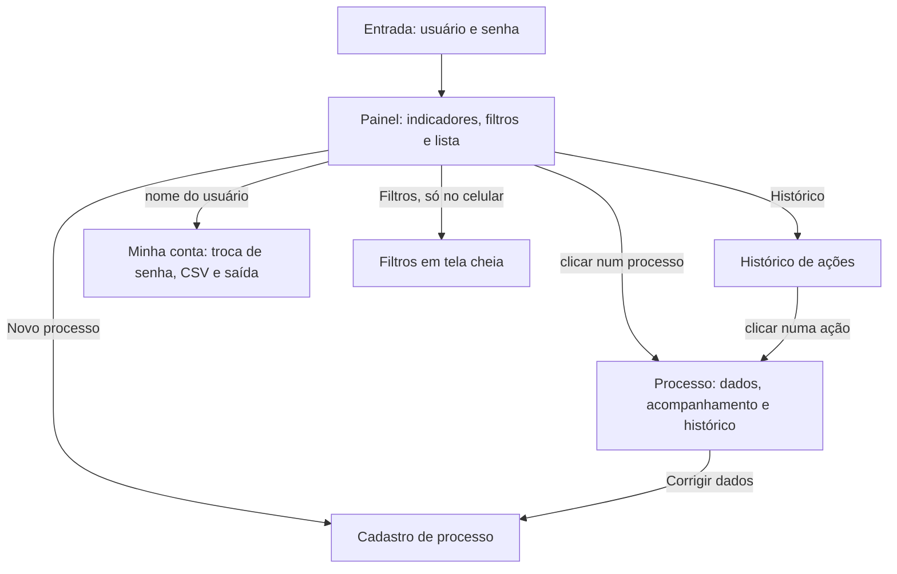

# Projeto de Interface

| Projeto | Documento | Versão | Data | Autor |
|---|---|---|---|---|
| Controle de Processos do Gabinete | 04. Projeto de Interface | 1.0 | 22/11/2026 | Bruno-LSO |

**Histórico de versões**

| Versão | Data | Autor | Alteração |
|---|---|---|---|
| 1.0 | 22/11/2026 | Bruno-LSO | Primeira versão |

## Fluxo de telas

## Telas

| Tela | Conteúdo | Requisitos |
|---|---|---|
| Entrada | Usuário, senha, botão Entrar | RF-001 |
| Painel | Topo com indicador "Ao vivo", 5 indicadores, barra de filtros, lista paginada pela altura da tela | RF-002, RF-003, RF-007, RF-008, RF-012 |
| Processo | Dados do processo e assunto; formulário de acompanhamento (situação, prioridade, datas, observação); histórico do processo. No celular, as 3 partes ficam em abas | RF-004, RF-005, RF-006, RF-011 |
| Cadastro | Órgão, números, tipo, relator, UF, localidade, situação AGS, assunto | RF-009 |
| Histórico | Busca, filtro por pessoa e por ação, lista paginada | RF-010, RF-011 |
| Minha conta | Nome, usuário, perfil, troca de senha, CSV, Sair | RF-013, RF-014 |

## Regras de tela

- Nada rola. A lista mostra quantas linhas cabem na altura da janela e passa as páginas com os botões ‹ e › ou com o gesto de deslizar no celular.
- Formulário que não cabe é dividido em partes ("Campos 1 de 2").
- Assunto longo diminui a fonte até 11 px. Se ainda não cabe, o botão "Ler assunto completo" abre o texto em partes.
- Telas não abrem por cima de outras: cada tela ocupa a área principal no lugar da lista.

As capturas de tela não ficam no repositório porque mostram processos reais e o repositório é público.
