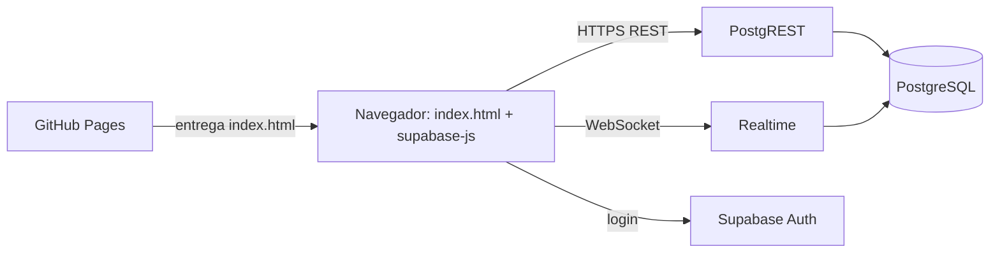
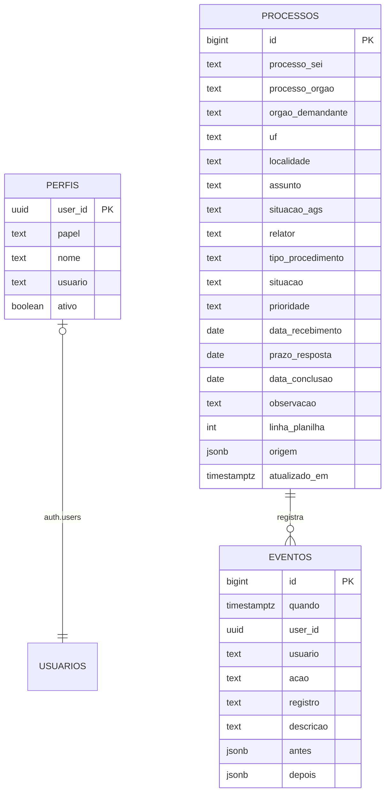

# Arquitetura da Solução

| Projeto | Documento | Versão | Data | Autor |
|---|---|---|---|---|
| Controle de Processos do Gabinete | 05. Arquitetura da Solução | 1.5 | 23/11/2026 | Bruno-LSO |

**Histórico de versões**

| Versão | Data | Autor | Alteração |
|---|---|---|---|
| 1.0 | 22/11/2026 | Bruno-LSO | Primeira versão |
| 1.1 | 22/11/2026 | Bruno-LSO | Regras de prazo por órgão e tipo, dias úteis ou corridos, feriados e cálculo automático |
| 1.2 | 22/11/2026 | Bruno-LSO | Projeto independente: perfis, log, rótulos, funções e logins no schema sispad |
| 1.3 | 22/11/2026 | Bruno-LSO | Identidade visual do Confea (design system do Claude Design), botão Início e ajuda com ? em cada seção |
| 1.4 | 23/11/2026 | Bruno-LSO | Prazo individual por processo, data de conclusão com botão Concluir e Painel com evolução e tempo de resolução |
| 1.5 | 23/11/2026 | Bruno-LSO | Só o prazo informado pelo órgão (saem regras de prazo e feriados) e análise do prazo dado por órgão |

## Componentes

## Projeto independente

O projeto Supabase `rmjlqngrfgorhcwaarou` hospeda vários projetos do Confea. Regra do Bruno de 22/11/2026: cada projeto é 100% independente. Este projeto não usa tabela, função nem schema de outro projeto, e nenhum outro projeto usa os dele. Apagar o schema `sispad` não afeta os outros projetos, e apagar outro schema não afeta este.

| Objeto do schema `sispad` | Função |
|---|---|
| `processos` | Dados do projeto |
| `perfis` | Usuário, papel (`admin`, `editor`, `leitor`), nome e login |
| `eventos` e `rotulos` | Log do projeto e nomes legíveis das colunas |
| `tem_papel(papéis)`, `nome_usuario()` | Conferem o papel e o nome de quem está logado |
| `registrar()` | Gatilho do log |
| `meu_perfil()`, `registrar_acesso()`, visão `historico` | Usados pela página |

As contas de login deste projeto usam o domínio `sispad.cnfpresiddata.local` (o usuário digita só `talita` ou `bruno`). Outros projetos têm contas próprias, com outro domínio. A troca de senha aqui não muda a senha de outro projeto.

Fora dos schemas dos projetos ficam só a infraestrutura do Supabase (`auth`, `storage`, `realtime`) e o sinal de atividade do banco (`manutencao.keepAlive` e `public.keepalive_enviar`), que nenhum projeto usa.

## Modelo de dados

## Prazos

Desde 23/11/2026 o prazo de cada processo é o informado pelo órgão demandante, gravado em `prazo_resposta`. As regras de prazo, os feriados e o cálculo automático saíram (migração `20261123150000_sispad_so_prazo_do_orgao.sql`).

| Objeto | Função |
|---|---|
| Gatilho `conferir_datas` em `processos` | Recusa data de recebimento e data de conclusão no futuro (fuso de São Paulo), conclusão antes do recebimento e prazo antes do recebimento. Só confere o campo que mudou |

## Conclusão e painel

| Item | Regra |
|---|---|
| Processo concluído | Tem `data_conclusao`. Ao concluir, a situação passa para Respondido, se não for Respondido nem Arquivado. Concluído não conta como em aberto nos indicadores |
| Tempo de resolução | Dias corridos de `data_recebimento` a `data_conclusao` |
| Concluído no prazo | `data_conclusao` até `prazo_resposta`, entre os concluídos com prazo informado |
| Recebidos e concluídos por período | Contados pela data de recebimento e pela data de conclusão. A semana começa na segunda-feira |
| Prazo dado | Dias corridos de `data_recebimento` a `prazo_resposta` |
| Estatística por órgão | Média, desvio padrão amostral, mediana, 1º e 3º quartis (interpolação linear), menor e maior prazo |
| Faixa normal e fora do padrão | Regra de Tukey: fora do padrão é o prazo abaixo de Q1 - 1,5 x IQR ou acima de Q3 + 1,5 x IQR, com IQR = Q3 - Q1. Só vale com 5 prazos ou mais do órgão. No painel, a faixa usa os processos dos filtros de órgão, tipo e UF, em qualquer período; na tela do processo, usa os outros processos do mesmo órgão |
| Cálculo | No navegador, sobre os processos já carregados (RNF-005). Nenhuma consulta nova ao banco |

Migração `20261123150000_sispad_so_prazo_do_orgao.sql`: página nova publicada antes; cópia de segurança de processos, `regras_prazo` (0 linhas), `feriados` (60 linhas), `rotulos` e funções; depois saíram as colunas `prazo_modo` e `regra_id`, as 2 tabelas, 7 funções e 3 gatilhos. Conferência campo a campo contra a cópia: 0 diferenças nos 673 processos.

Migração `20261123120000_sispad_prazo_individual_e_conclusao.sql`: cópia de segurança antes; os 673 processos passaram para `prazo_modo = 'manual'` com os gatilhos de carimbo e de log desligados só nessa troca, para manter quem alterou e quando; conferência depois, campo a campo, contra a cópia: nenhum valor mudou além da forma do prazo.

## Regras de acesso (RLS)

| Tabela | Ler | Criar e alterar | Excluir |
|---|---|---|---|
| `sispad.processos` | perfil `admin`, `editor` ou `leitor` em `sispad.perfis` | `admin` ou `editor` | `admin` |
| `sispad.eventos` | perfil em `sispad.perfis` | só os gatilhos e as funções do projeto | ninguém |
| `sispad.perfis` | o próprio usuário | só o administrador do banco | só o administrador do banco |

A função `sispad.tem_papel(papéis)` decide o acesso. As funções `registrar` e `nome_usuario` não podem ser chamadas pela API. O cadastro livre de contas está desligado no Auth.

## Log

O gatilho `sispad.registrar()` grava cada ação em `sispad.eventos` cada inclusão, alteração e exclusão com a pessoa, a hora, os valores antes e depois e uma frase como: `Talita alterou o processo 017.048/2026-5: Prioridade: "Crítica" (antes sem valor).` A entrada, a saída e a troca de senha entram pela função `sispad.registrar_acesso`.

## Importação

`supabase/importar_planilha.py` lê a planilha, troca "-" por vazio, troca "PF" por "Polícia Federal" e grava a linha original inteira em `origem`. Resultado conferido em 22/11/2026: 673 linhas na planilha, 673 no banco; 34 da Polícia Federal (22 "Polícia Federal" e 12 "PF"); 343 com UF (345 menos 2 com "-").

## Qualidade (ISO/IEC 25010)

| Característica | Medida | Resultado |
|---|---|---|
| Adequação funcional | RF implementados | 21 de 21 |
| Eficiência | Consultas ao abrir | 3 (perfil, processos, histórico) |
| Usabilidade | Telas sem rolagem e sem sobreposição | 78 de 78 combinações de tela testadas |
| Segurança | Acesso sem login aos processos | Recusado (HTTP 401) |
| Confiabilidade | Alteração sobre versão antiga | Recusada (CT-10); a tela recarrega e avisa |
