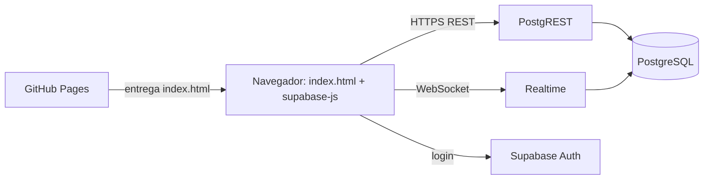
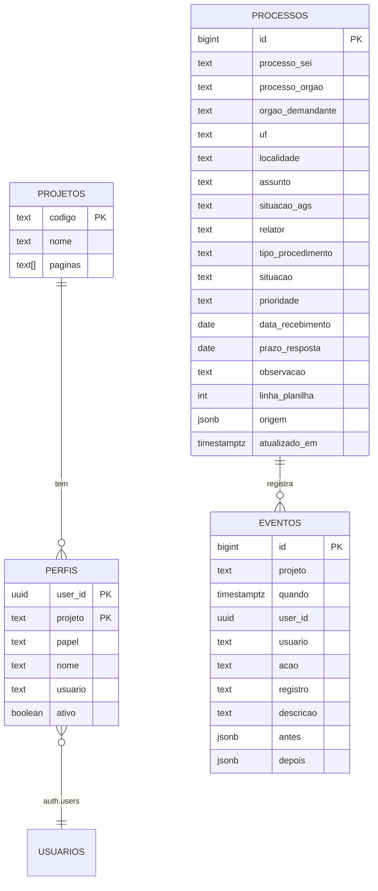

# Arquitetura da Solução

| Projeto | Documento | Versão | Data | Autor |
|---|---|---|---|---|
| Controle de Processos do Gabinete | 05. Arquitetura da Solução | 1.1 | 22/11/2026 | Bruno-LSO |

**Histórico de versões**

| Versão | Data | Autor | Alteração |
|---|---|---|---|
| 1.0 | 22/11/2026 | Bruno-LSO | Primeira versão |
| 1.1 | 22/11/2026 | Bruno-LSO | Regras de prazo por órgão e tipo, dias úteis ou corridos, feriados e cálculo automático |

## Componentes

## Organização do banco compartilhado

O projeto Supabase `rmjlqngrfgorhcwaarou` atende vários projetos do Confea. Cada projeto tem um schema próprio.

| Schema | Conteúdo | Exposto na API |
|---|---|---|
| `acesso` | `projetos` (catálogo) e `perfis` (usuário, projeto, papel) | Não |
| `auditoria` | `eventos` (log de todos os projetos) e `rotulos` (nomes legíveis das colunas) | Não |
| `sispad` | Este projeto: `processos`, visão `historico`, funções `meu_perfil` e `registrar_acesso` | Sim |
| `jogo_confea` | Jogo do Confea (gameCONFEA, AdmGameCONFEA, PostitGameCONFEA) | Sim |
| `arquivo` | Cópias de segurança antigas do jogo, sem acesso pela API | Não |
| `manutencao` | Tabela `keepAlive` do sinal de atividade | Não |
| `public` | Só a função `keepalive_enviar`, mantida para quem já a chama | Sim |

## Modelo de dados

## Prazos

| Objeto | Função |
|---|---|
| `sispad.regras_prazo` | Órgão (ou qualquer), tipo (ou qualquer), dias, contagem (`corridos` ou `uteis`), prorrogar. Um par órgão e tipo só aparece uma vez (`unique nulls not distinct`) |
| `sispad.feriados` | Dias sem expediente. Começa com os feriados nacionais de 2025 a 2030 |
| `sispad.regra_para(órgão, tipo)` | Escolhe a regra mais específica: órgão e tipo, depois só o tipo, depois só o órgão, depois a regra geral |
| `sispad.somar_prazo(início, dias, contagem, prorrogar)` | Conta a partir do dia seguinte ao recebimento (Lei 9.784/1999, art. 66). Dias úteis: pula sábado, domingo e feriado. Dias corridos: se prorrogar, passa para o próximo dia útil |
| Gatilho `calcular_prazo` em `processos` | Com `prazo_modo = 'regra'`, grava `regra_id` e `prazo_resposta`. Com `manual`, mantém a data digitada |
| Gatilho `recalcular` em `regras_prazo` e `feriados` | Recalcula os processos que seguem regra e grava uma linha no log com o número de processos; o log por processo fica em silêncio nesse lote (`auditoria.silenciar`) |

A página repete o cálculo no navegador (`somarPrazo`, `regraPara`) só para mostrar o prazo antes de salvar. O valor gravado é sempre o do banco.

## Regras de acesso (RLS)

| Tabela | Ler | Criar e alterar | Excluir |
|---|---|---|---|
| `sispad.processos` | perfil `admin`, `editor` ou `leitor` no projeto `sispad` | `admin` ou `editor` | `admin` |
| `auditoria.eventos` | quem tem perfil no projeto do evento | só os gatilhos (função com privilégio do dono) | ninguém |
| `sispad.regras_prazo` e `sispad.feriados` | perfil no projeto `sispad` | `admin` ou `editor` | `admin` ou `editor` |
| `acesso.perfis` | o próprio usuário | só o administrador do banco | só o administrador do banco |

A função `acesso.tem_papel(projeto, papéis)` decide o acesso. O cadastro livre de contas está desligado no Auth.

## Log

O gatilho `auditoria.registrar()` grava cada inclusão, alteração e exclusão com a pessoa, a hora, os valores antes e depois e uma frase como: `Talita alterou o processo 017.048/2026-5: Prioridade: "Crítica" (antes sem valor).` A entrada, a saída e a troca de senha entram pela função `sispad.registrar_acesso`.

## Importação

`supabase/importar_planilha.py` lê a planilha, troca "-" por vazio, troca "PF" por "Polícia Federal" e grava a linha original inteira em `origem`. Resultado conferido em 22/11/2026: 673 linhas na planilha, 673 no banco; 34 da Polícia Federal (22 "Polícia Federal" e 12 "PF"); 343 com UF (345 menos 2 com "-").

## Qualidade (ISO/IEC 25010)

| Característica | Medida | Resultado |
|---|---|---|
| Adequação funcional | RF implementados | 18 de 18 |
| Eficiência | Consultas ao abrir | 3 (perfil, processos, histórico) |
| Usabilidade | Telas sem rolagem e sem sobreposição | 78 de 78 combinações de tela testadas |
| Segurança | Acesso sem login aos processos | Recusado (HTTP 401) |
| Confiabilidade | Alteração sobre versão antiga | Recusada (CT-10); a tela recarrega e avisa |
